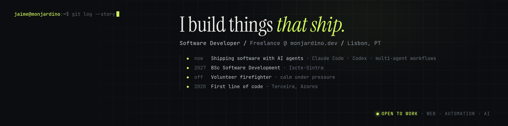

```console
jaime@monjardino:~$ whoami
Software developer · Freelance @ monjardino.dev · Lisbon, PT
Shipping software with AI agents and multi-agent workflows.
```

```console
jaime@monjardino:~$ git log --story --oneline
* now   Shipping software with AI agents (Claude Code, Codex)
* 2027  BSc Software Development · Iscte-Sintra
* off   Volunteer firefighter · calm under pressure
* 2020  First line of code · Terceira, Azores
```

### `ls ~/projects --featured`

| Project | What it is | Stack | Status |
|---|---|---|---|
| **[RIG](https://app-rig.monjardino.dev/)** | An agentic operating system for solo contractors: answers the calls they can't take, turns a job-site photo into a priced quote, and keeps the day's jobs in one feed. | React · Firebase · Gemini · Vapi | `in production` |
| **[AAIT](https://github.com/jmonjardino/aait)** | Website and content platform for the Athletics Association of Terceira Island. | Next.js · TypeScript · Firebase | `client project` |
| **[Zonecraft](https://github.com/jmonjardino/zonecraft)** | A GNOME Shell window organizer that never moves anything behind your back: draw a grid per monitor, assign windows, apply. | TypeScript · GJS · GTK4 | `early dev` |

### `cat stack.txt`

```text
lang      TypeScript · JavaScript · Python · Java
web       React · Next.js · Astro · Tailwind
backend   Firebase · Node.js
ai        Claude Code · Codex · Gemini · agent orchestration
```

### `./contact`

[monjardino.dev](https://monjardino.dev) · [jrsmonjardino@gmail.com](mailto:jrsmonjardino@gmail.com) · open to work
